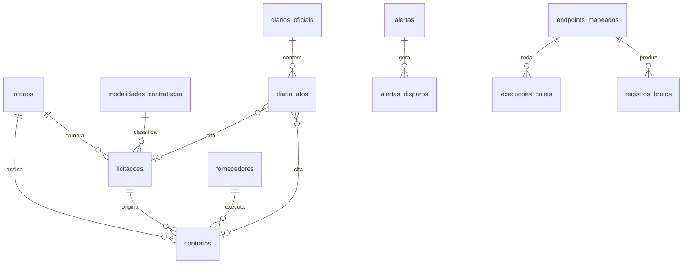

# Painel de Transparência Cívica de Franca-SP

Plataforma open-source que consolida licitações, contratos e o Diário Oficial da Prefeitura e da
Câmara de Franca (IBGE `3516200`), enriquece com IA e apresenta tudo num painel para cidadãos.

## Estrutura do monorepo

```
franca-transparencia/
├── docker-compose.yml          # Postgres 16 + migrations + collector (profile "collect")
├── .env.example
├── Makefile                    # atalhos: up, migrate, collect, test, psql
├── database/
│   └── migrations/             # golang-migrate: NNNNNN_nome.{up,down}.sql
│       ├── 000001_extensoes_e_funcoes      pg_trgm, unaccent, config FTS "pt_unaccent"
│       ├── 000002_dominios_e_orgaos        modalidades (Lei 14.133), órgãos compradores
│       ├── 000003_fornecedores
│       ├── 000004_licitacoes
│       ├── 000005_contratos                + triggers de vínculo contrato ↔ licitação
│       ├── 000006_diarios_oficiais         + diario_atos (atos segmentados do DOMF)
│       ├── 000007_alertas                  assinaturas + disparos deduplicados
│       ├── 000008_coleta_e_endpoints       registro REA, execuções, camada bruta
│       ├── 000009_views_painel             views dos cards e rankings
│       ├── 000010_valores_sem_check        valores negativos da fonte entram (sinal de qualidade)
│       ├── 000011_itens_licitacao          itens, resultados por item e preços praticados
│       └── 000012_qualidade_dados          natureza (receita/despesa) e alertas de qualidade
├── services/
│   ├── collectors/             # Python 3.11+
│   │   ├── franca_collectors/
│   │   │   ├── pncp/           # client, normalize, pipeline, domínios
│   │   │   ├── rea/            # spec YAML, executor genérico, triagem de HAR
│   │   │   ├── storage/        # sinks: console, jsonl, postgres (upsert idempotente)
│   │   │   ├── models.py       # modelos normalizados (pydantic)
│   │   │   └── cli.py
│   │   ├── endpoints/          # endpoints mapeados via REA (YAML versionado)
│   │   └── tests/
│   │   (próximo: domf/ — download, extração/OCR e Structured Outputs do Diário Oficial)
│   └── api/                    # Go: cmd/api + internal/{handler,service,repository}
├── apps/
│   └── web/                    # Next.js + Tailwind + shadcn/ui (a iniciar)
└── docs/
    ├── rea.md                  # como mapear APIs internas dos portais
    └── PLANO.md                # checklist do projeto
```

## Modelo de dados



Decisões que valem saber:

- **Id natural do PNCP como chave de upsert** (`id_pncp` = `numeroControlePNCP`). Reprocessar não duplica;
  registros idênticos (mesmo `payload_hash`) nem geram escrita.
- **JSON original guardado** em `payload_bruto`: dá para renormalizar sem recoletar e auditar qualquer número.
- **`orgaos` é tabela, não texto**: Franca tem vários CNPJs compradores (Prefeitura, Câmara, autarquias, fundos).
  O collector descobre os que aparecem no PNCP; a Prefeitura (47.970.769/0001-04) já vem semeada.
- **CNPJ alfanumérico** (em vigor desde jul/2026) aceito em todo o schema e na normalização.
- **Vínculo contrato ↔ licitação resolvido pelo banco** em qualquer ordem de chegada (triggers).
- **Datas do PNCP vêm sem fuso** e são gravadas como `timestamptz` no horário de Brasília.
- **Busca full-text em português sem acento** (`pt_unaccent`) com pesos (objeto > unidade > complemento).
- **"Secretaria" ≈ `unidade_nome`** (unidade compradora do PNCP). Se Franca publicar tudo numa unidade só,
  a secretaria terá de vir do portal municipal ou do DOMF.
- **LGPD**: CPF de fornecedor PF e contatos de alertas são dados pessoais; a API pública deve mascará-los.

## Rodando

```bash
cp .env.example .env                       # troque a senha
docker compose up -d db migrate            # Postgres 16 + schema
docker compose run --rm collector pncp coletar --desde 2026-01-01 --saida postgres
docker compose run --rm collector pncp abertas --saida postgres     # radar de propostas abertas
```

Sem Docker, só para ver os dados chegando:

```bash
cd services/collectors
pip install -e ".[postgres,dev]"
python -m franca_collectors pncp coletar --desde 2026-10-01 --ate 2026-10-27          # imprime no console
python -m franca_collectors pncp coletar --desde 2026-10-01 --saida jsonl --arquivo out.jsonl
pytest
```

## Coleta PNCP

1. `/v1/contratacoes/publicacao` filtrado por `codigoMunicipioIbge=3516200`, uma consulta por modalidade
   (a API exige o código), em janelas de 30 dias.
2. `/v1/contratos`, que **não filtra por município**: consulta por `cnpjOrgao` usando os CNPJs configurados
   e os descobertos no passo 1.
3. Unidades estaduais/federais sediadas em Franca são descartadas (`--todas-esferas` para incluí-las).
4. `--incremental` retoma da última janela bem-sucedida (tabela `execucoes_coleta`) com 3 dias de sobreposição.

O HTTP tem retry com backoff para 429/5xx, intervalo mínimo entre chamadas e falha fechada se a fonte
devolver HTML (página de manutenção/desafio) em vez de JSON.

## Próximos passos

O plano completo, em formato de checklist, está em [`docs/PLANO.md`](docs/PLANO.md).
